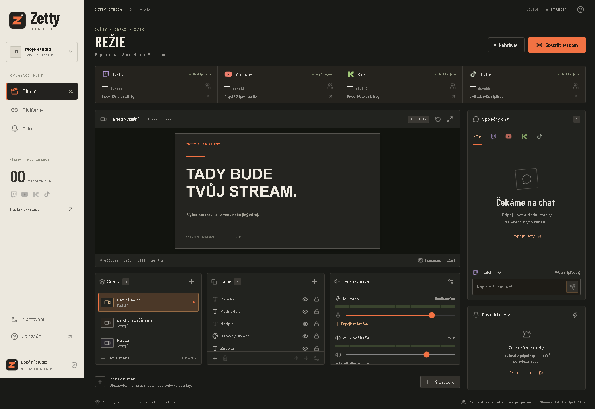

# Zetty Studio

Samostatná desktopová streamovací aplikace pro **Windows 10/11 x64**. Vlastní scény, obraz, zvuk a multistream bez OBS. Rozhraní je v češtině.

**Stav: první funkční vývojová verze 0.1.1.** Není to úplná náhrada všech funkcí OBS. Veřejná OAuth aplikace a přístup k platformám nejsou součástí zdrojového kódu. Dostupnost integrací závisí na oprávněních a API poskytovatelů.



Verze 0.1.1 přináší název **Zetty Studio**, vlastní oranžovou ikonu Z a nové grafitové rozhraní se světlým bočním panelem. Instalátor vytvoří zástupce **Zetty Studio** na ploše i v nabídce Start. Ikona obsahuje devět velikostí od 16 do 256 px pro různé DPI. Původní profil a identita instalátoru zůstávají zachované, aby přejmenování nesmazalo uložené účty a scény.

## Co aplikace obsahuje

- Editor scén: přidání, přejmenování, kopie, smazání, barva pozadí a přepínání pomocí Alt + 1–9.
- Zdroje: monitor nebo okno, kamera, obrázek, video, text, barevná plocha, webový zdroj a alerty.
- Vrstvy, viditelnost, zámek, průhlednost, tažení a změna velikosti v náhledu; vlastnosti otevře dvojklik na zdroj.
- Vlastní kompozitor Canvas a zvukový mixér Web Audio. Mikrofon, systémový zvuk a zvuk videí.
- FFmpeg H.264/AAC výstup na více RTMP/RTMPS cílů současně. Video se enkóduje jednou.
- CPU x264 nebo GPU NVIDIA NVENC, AMD AMF, Intel Quick Sync, podle podpory stroje.
- 720p/1080p, vodorovný i svislý obraz, 30/60 FPS, datový tok videa a zvuku.
- Místní nahrávání do WebM, které funguje i bez připojených platforem.
- Společný chat s ikonou původu zprávy. Odesílání na jednu vybranou platformu.
- Počty diváků z připojených API obnovované po 15 sekundách; nedostupná data se zobrazují jako „—“.
- Samostatný panel alertů, historie aktuální relace, test alertu a zdroj alertů do obrazu.
- Automatické uložení projektu, import/export JSON a vrácení změn Ctrl+Z.
- Šifrované přihlašovací údaje v profilu Windows přes Electron safeStorage / DPAPI. Klíče se nevrací do UI.

## Dostupnost platforem

| Platforma | Vysílání                                         | Přihlášení                                  | Chat a alerty                                                          | Diváci                            |
| --------- | ------------------------------------------------ | ------------------------------------------- | ---------------------------------------------------------------------- | --------------------------------- |
| Twitch    | RTMP/RTMPS                                       | OAuth device flow, vlastní public Client ID | EventSub WebSocket; follow, sub, gift, resub, bits, raid               | API /streams, 15 s                |
| YouTube   | RTMP/RTMPS, připravený přenos v YouTube Studiu   | Google desktop OAuth + PKCE                 | Live Chat API; text, Super Chat/Sticker, podporované události členství | videos.liveStreamingDetails, 15 s |
| Kick      | Server a klíč z Kick dashboardu                  | Osobní OAuth aplikace + PKCE                | Oficiální webhook přes vlastní relay server                            | Public API, 15 s                  |
| TikTok    | Pouze pokud účet má přidělený RTMP server a klíč | LIVE přihlášení není v této verzi dostupné  | Vyžaduje oprávněnou partnerskou integraci, v této verzi nedostupné     | Nedostupné                        |

Žádné ukázkové chaty, diváci ani připojené účty se nepředstírají. Testovací alerty jsou viditelně označené TEST. OAuth připojení umožní práci s účtem v aplikaci; aplikace nemá centrální cloudový účet nebo vlastní serverové přihlašování.

## Spuštění ze zdrojového kódu

Požadavky: Node.js 24 LTS, npm a Windows x64. FFmpeg se stáhne jako závislost. OBS není potřeba.

```powershell
npm ci
npm run dev
```

Produkční spuštění:

```powershell
npm run build
npm start
```

`npm run dev:web` je pouze náhled rozhraní v prohlížeči; desktopové funkce zde nejsou dostupné.

## První stream

1. V panelu Zdroje přidej obrazovku nebo okno a kameru. Pro fullscreen hru použij bezokrajový režim; přímý game hook zatím není implementovaný.
2. V mixéru klikni na Připojit mikrofon. Systémový zvuk se bere ze sdílení obrazovky. Sluchátka zabrání zpětné vazbě. Na jedné scéně používej jeden zdroj systémového zvuku.
3. Na stránce Platformy u každého cíle vyplň RTMP/RTMPS server a streamovací klíč. Zapni přepínače Cíl multistreamu.
4. V Nastavení vyber rozlišení, FPS a enkodér. GPU potřebuje odpovídající ovladače. Pokud enkodér při spuštění selže, použij CPU x264.
5. Spusť stream a ověř přenos v dashboardu každé platformy. YouTube přenos vytvoř předem; API klíč je samostatný od OAuth přihlášení. TikTok musí účtu povolit LIVE a externí RTMP vysílání.

Příklad: 6000 kb/s video + 160 kb/s zvuk na dvou platformách spotřebuje přibližně 12,3 Mb/s uploadu; počítej s další rezervou. Stav „Výstup aktivní“ potvrzuje běh enkodéru, nikoli přehratelnost streamu na všech platformách. Stav živého přenosu potvrzuje API platformy. Selhání některého RTMP cíle se hlásí a FFmpeg se pokouší obnovit spojení.

## Propojení účtů

Podrobnosti a zdroje jsou v [docs/INTEGRATIONS.md](docs/INTEGRATIONS.md). Pro místní vývoj použij vlastní registrované aplikace. **Client Secret veřejné Kick aplikace nikdy nezabudovávej do instalátoru.** Pro distribuci s jednoduchým přihlášením všem uživatelům je potřeba doplnit serverovou OAuth bránu a schválení poskytovatelů. YouTube testovací OAuth projekt omezuje účty na přidané testery a platnost tokenů.

## Instalátor a GitHub

```powershell
npm run dist
```

Instalátor se vytvoří v `release/Zetty-Studio-0.1.1-Setup.exe`. `npm run pack` vytvoří rozbalenou desktopovou verzi. Lokální build není podepsaný certifikátem vydavatele.

Projekt lze nahrát do vlastního GitHub repozitáře. Workflow `ci.yml` kontroluje sestavení a testy. Při pushi tagu `v0.1.1` workflow `release.yml` vytvoří Windows instalátor a připojí jej do GitHub Release. Před veřejným vydáním nastav vlastní identitu vydavatele, ověř OAuth integrace, přidej podpis instalátoru a splň distribuční podmínky přibalených komponent popsané v [THIRD_PARTY.md](THIRD_PARTY.md).

## Kontroly

```powershell
npm run typecheck
npm test
npm run build
npm run test:ui
```

Desktopové testy běží v odděleném dočasném profilu. Používají syntetickou kameru a mikrofon, vytvoří skutečný záznam a pošlou skutečný stream na lokální RTMP přijímač. Nepřihlašují se k účtům a nevysílají na veřejné platformy.

## Omezení první verze

- Zatím chybí přímé zachytávání her, filtry obrazu a zvuku, přechody, studio s odděleným programem/náhledem, klávesové zkratky mimo okno aplikace, pokročilá moderace a pluginový systém.
- Canvas → MediaRecorder WebM → FFmpeg H.264 je přenosný výstupní řetězec, který má větší režii než nativní GPU kompozitor. Před ostrým streamem ověř výkon svého počítače. Pro 1080p60 může být vhodné GPU enkódování nebo snížení kvality.
- Všechny multistream cíle dostávají stejný obraz, FPS a datový tok. Samostatný svislý a vodorovný výstup současně zatím není podporovaný.
- Systémový zvuk je celopočítačový; výběr okna neizoluje zvuk jedné aplikace. Webové zdroje se vykreslují do obrazu až 15 FPS a mají vypnutý zvuk.
- YouTube chat používá polling alespoň 15 s a respektuje `pollingIntervalMillis`. Čerpá kvótu projektu. Po vyčerpání kvóty je nutné počkat nebo navýšit kvótu. Novější streamList je vhodný další krok.
- Dostupné alerty odpovídají dokumentovaným událostem napojených API. Dary přes externí služby se zatím nenačítají.
- Po opětovném spuštění aplikace znovu připoj kameru, obrazovku a mikrofon. Místní média musí zůstat ve vybraných cestách; jiný počítač je musí znovu vybrat.

Architektura a bezpečnost: [docs/ARCHITECTURE.md](docs/ARCHITECTURE.md).
